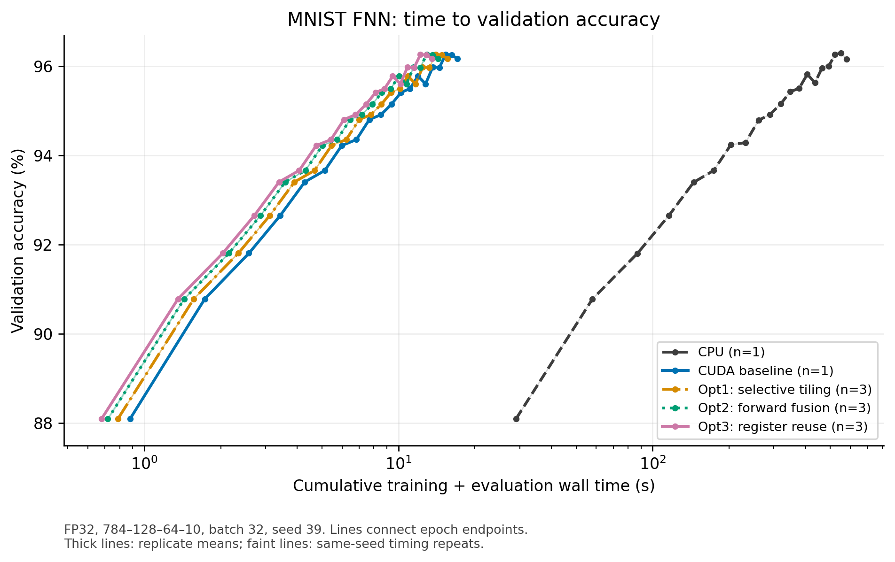

# ESE366 Project 2: CPU and CUDA FNN

## Project overview

This ESE366 project implements a feedforward neural network (FNN) in C and CUDA
to classify handwritten digits from MNIST. Starting from a CPU reference and a
plain CUDA baseline, profiling guides three rounds of GPU optimization. The
goal is to reduce training time while preserving numerical correctness and
classification performance, rather than changing the model or learning rule.

## How the FNN works

The network learns from labeled examples: each image comes with its correct
digit. Training adjusts numerical parameters so that future predictions better
match those labels.

1. **Prepare the image.** Normalize each pixel of a 28×28 grayscale image to
   the range [0, 1], then flatten the image into 784 input values.
2. **Connect the layers.** Pass those values through a fully connected
   784→128→64→10 network. Hidden layers use ReLU; the output layer produces ten
   logits, or unnormalized scores, one for each digit.
3. **Predict and measure error.** A forward pass produces the scores and a
   predicted class. Softmax cross-entropy compares the scores with the true
   label to measure how wrong the prediction is.
4. **Learn from the error.** Backpropagation calculates gradients describing
   how each parameter affects the loss. Mini-batch SGD updates the weights
   and biases using groups of training images.

Inference performs only prediction and never updates parameters. Within a
batch, dense layers and gradient calculations become matrix operations—the
main targets for CUDA parallelism in this project.

## CUDA optimizations and results

- **Opt1 — selective tiling:** use shared-memory tiling for eligible dA1
  calculations. The earlier broad-tiling attempt showed that not every matrix
  shape benefits from tiling.
- **Opt2 — forward fusion:** combine forward GEMM, bias addition and activation
  to reduce kernel launches and intermediate memory accesses.
- **Opt3 — register reuse:** compute two dW1 outputs per thread, reusing
  operands held in registers.

All comparisons use FP32, SGD with learning rate 0.01, batch size 32 and seed
39, with 48,000 training, 12,000 validation and 10,000 test images.

| Version | Time to 95% validation accuracy (s) |
|---|---:|
| CPU | 319.108 |
| CUDA baseline | 9.386 |
| Opt1 | 8.568 |
| Opt2 | 7.889 |
| Opt3 | 7.460 |

Time is cumulative measured epoch wall time, including shuffle, training and
each epoch's training/validation evaluation; setup, warm-up, final test and
export are excluded. CPU and baseline each have one run; Opt1–3 each have
three same-seed timing repeats. These measurements are separate from train-only
GPU event timings and do not measure variation across random seeds.



See the [detailed results](results/time_accuracy/20261112/README.md) for
threshold calculations, other figures and measurement limitations.

A separate incremental experiment loads an existing checkpoint and continues
training on 8,000 images that were not used in the initial training stage.
Validation accuracy rises from 94.4917% to 94.8250%; this demonstrates continued
learning, not a fourth CUDA optimization or superiority over training from
scratch.

## Repository layout

- `cpu/`: CPU reference and training entry.
- `cuda_00_baseline/`: plain CUDA implementation.
- `cuda_01_selective_tiling/`, `cuda_02_forward_fusion/`,
  `cuda_03_register_reuse/`: the three optimized versions.
- `cuda_01_tiling_attempt/`: failed broad-tiling experiment and its explanation.
- `incremental/`: checkpoint loading, saving and continued training.
- `scripts/`: dataset preparation, experiments and analysis.
- `results/`: retained measurements and figures.
- `docs/`: technical guides and supporting documentation.

## Quick start

Run these commands from the repository root on a CUDA-capable Jetson Orin Nano
with GCC, GNU Make and nvcc available. The final configuration uses 128
one-dimensional threads per block, tile16, selective tiling, forward fusion
and two dW1 outputs per thread.

```bash
set -e
export PATH=/usr/local/cuda/bin:$PATH
bash scripts/download_mnist.sh
make -C cuda_03_register_reuse ARCH=sm_87
./cuda_03_register_reuse/fnn_cuda_opt3 --check
mkdir -p outputs
RUN=$(mktemp -d outputs/opt3_XXXXXX)
./cuda_03_register_reuse/fnn_cuda_opt3 data/mnist 20 0.01 32 "$RUN" 128 16 targeted on 2
```

The [usage guide](docs/time_accuracy_incremental.md) covers CPU and other
versions, checkpoint/resume, correctness checks and plot reproduction.

## Credits

The CPU foundation comes from
[marcusvel28/ESE_366_PSoC_Labs](https://github.com/marcusvel28/ESE_366_PSoC_Labs),
the upstream repository, with credit retained by its original author.
The CUDA implementation and profiling-driven optimizations build on that work.
